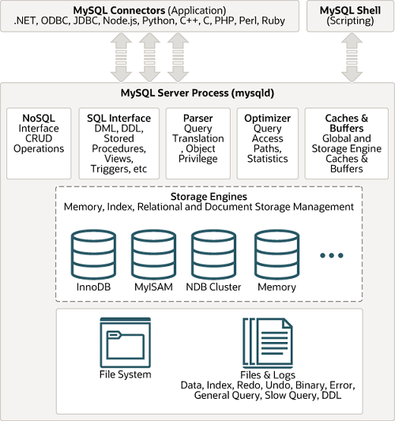

# Overview of MySQL Storage Engine Architecture(MySQL存储引擎架构概述)
&nbsp;&nbsp;The MySQL pluggable storage engine architecture enables a database professional to select a specialized storage engine for a particular application need while being completely shielded from the need to manage any specific application coding requirements. The MySQL server architecture isolates the application programmer and DBA from all of the low-level implementation details at the storage level, providing a consistent and easy application model and API. Thus, although there are different capabilities across different storage engines, the application is shielded from these differences.(MySQL可插拔存储引擎架构使数据库专业人员能够为特定的应用程序需求选择专门的存储引擎，同时完全不需要管理任何特定的应用程序编码需求。MySQL服务器架构将应用程序程序员和DBA与存储层的所有底层实现细节隔离开来，从而提供了一致且简单的应用程序模型和API。因此，尽管在不同的存储引擎之间存在不同的功能，但应用程序不会受到这些差异的影响。)

## MySQL Architecture with Pluggable Storage Engines
<div style="margin-left:30px;"></div>


&nbsp;&nbsp;The pluggable storage engine architecture provides a standard set of management and support services that are common among all underlying storage engines. The storage engines themselves are the components of the database server that actually perform actions on the underlying data that is maintained at the physical server level.(可插拔存储引擎体系结构提供了一组标准的管理和支持服务，这些服务在所有底层存储引擎中都是通用的。存储引擎本身是数据库服务器的组件，它实际对维护在物理服务器级别的底层数据执行操作。)

&nbsp;&nbsp;This efficient and modular architecture provides huge benefits for those wishing to specifically target a particular application need—such as data warehousing, transaction processing, or high availability situations—while enjoying the advantage of utilizing a set of interfaces and services that are independent of any one storage engine.(这种高效的模块化体系结构为那些希望专门针对特定应用程序需求(如数据仓库、事务处理或高可用性情况)的人提供了巨大的好处，同时享受利用一组独立于任何存储引擎的接口和服务的优势。)

&nbsp;&nbsp;The application programmer and DBA interact with the MySQL database through Connector APIs and service layers that are above the storage engines. If application changes bring about requirements that demand the underlying storage engine change, or that one or more storage engines be added to support new needs, no significant coding or process changes are required to make things work. The MySQL server architecture shields the application from the underlying complexity of the storage engine by presenting a consistent and easy-to-use API that applies across storage engines.(应用程序程序员和DBA通过位于存储引擎之上的连接器api和服务层与MySQL数据库交互。如果应用程序更改带来了需要更改底层存储引擎的需求，或者需要添加一个或多个存储引擎以支持新需求，则不需要进行重大的编码或流程更改即可使其正常工作。MySQL服务器架构通过提供一个适用于存储引擎的一致且易于使用的API，使应用程序免受存储引擎底层复杂性的影响。)

---

## Server 层与存储引擎层：8.0.30 源码对照（ASCII 流程图）

> **互通**：上图是官方概念组件图，本节把图中每个组件落到 `001.SOURCE_CODE/001.mysql-server-8.0.30-GA/mysql-8.0.30-server` 的具体**文件:行号**（全部 grep/Read 核实），可对照源码学习。一条 SQL 的完整执行链路见 [004.MySQL执行流程/000.一条SQL的执行全链路(基于8.0.30源码)](./004.MySQL执行流程/000.一条SQL的执行全链路(基于8.0.30源码).md)；"分层架构与查询优化的关系"总纲见 [002.MySQL查询优化技术/README.md](./002.MySQL查询优化技术/README.md)；优化器内部拆解见 [002.MySQL查询优化技术/010.MySQL查询优化器/](./002.MySQL查询优化技术/010.MySQL查询优化器/README.md)。

### 一、官方架构图的源码版分层总图

```
  Connectors: JDBC / ODBC / .NET / PHP / C API …（客户端驱动, 不在服务器进程内）
        │  TCP socket / Unix socket / 共享内存 / 命名管道
        │  (监听器: conn_handler/socket_connection.cc:1343
        │   Mysqld_socket_listener::listen_for_connection_event)
        ▼
┌─ MySQL Server ──────────────────────────────────────────────────┐
│ ① 连接管理与安全（官方图第一层）                                  │
│   connection_event_loop      conn_handler/connection_acceptor.h:60│
│     └ while: listen_for_connection_event → process_new_connection │
│                                 conn_handler_manager.cc:251        │
│   handle_connection(连接线程入口) conn_handler_per_thread.cc:245   │
│     ├ init_new_thd 创建 THD              :263                     │
│     ├ thd_prepare_connection 认证/授权   sql/sql_connect.cc:882    │
│     └ do_command 命令循环(每连接一个)    sql/sql_parse.cc:1234     │
│─────────────────────────────────────────────────────────────────│
│ ② SQL 层（官方图: SQL接口 / 解析器 / 优化器 / 内置函数）           │
│   命令分发 dispatch_command         sql/sql_parse.cc:1610          │
│   词法+语法解析 parse_sql           sql/sql_parse.h:68(调用:5135)  │
│   逻辑优化(规则) Query_block::prepare   sql/sql_resolver.cc:173    │
│   物理优化(代价) JOIN::optimize         sql/sql_optimizer.cc:281   │
│   执行驱动 ExecuteIteratorQuery      sql/sql_union.cc:1185         │
│     └ Iterator树: CreateIteratorFromAccessPath                     │
│                    join_optimizer/access_path.cc:333               │
│   内置函数/表达式 Item 体系          sql/item.h:802                 │
│   binlog(组提交:8406/XA协调者) MYSQL_BIN_LOG  sql/binlog.h:139    │
│                                   ★Server层                       │
│─────────────────────────────────────────────────────────────────│
│ ③ ★ handler 抽象层 —— Server ↔ 引擎 的插件边界(下图第四节展开)    │
│   class handler   (表级: 每表每查询一个实例)  sql/handler.h:4290   │
│   struct handlerton (引擎级: 每引擎一个)      sql/handler.h:2542   │
│   行访问入口 ha_rnd_init/ha_rnd_next/ha_index_next  handler.h:4611-│
│                                                   4623            │
│   行数估算 records_in_range      sql/handler.h:5394                │
│   ICP 下推 idx_cond_push         sql/handler.h:5821                │
└──────────────────────────────────────────────────────────────────┘
        │  虚函数跨界（插件接口契约, include/mysql/plugin.h）
        ▼
┌─ 存储引擎插件层（storage/ 目录, 可插拔）─────────────────────────┐
│ InnoDB(默认): 插件描述符 mysql_declare_plugin                     │
│                  storage/innobase/handler/ha_innodb.cc:23332      │
│   innodb_init 填 handlerton 回调(82处赋值)   ha_innodb.cc:5097    │
│   扫描 rnd_next :10796 → general_fetch :10493                     │
│     → row_search_mvcc(行锁/MVCC/ICP判定)                          │
│        storage/innobase/row/row0sel.cc:4363                       │
│   内存/文件: buf pool(buf0buf.cc) · redo(log0sys.h:74 log_t,      │
│     8.0.30 新redo子系统) · undo · B+树(btr0cur.cc)               │
│ 其他引擎: myisam / heap(MEMORY) / csv / archive / blackhole /     │
│   federated / example / myisammrg(MERGE) / ndb                    │
│ TempTable: 8.0 起内部临时表独立成引擎 storage/temptable           │
└──────────────────────────────────────────────────────────────────┘
        ▼
   文件系统层: *.ibd / #innodb_redo/#ib_redo*(redo, log0constants.h:69;
     老库升级才见 ib_logfile*) / undo表空间 / binlog.* / …
```

### 二、Server 层组件 → 源码映射表

| 官方图组件 | 8.0.30 落点 | DBA 关注点 |
|---|---|---|
| Connectors | 客户端驱动（进程外） | 协议在 `sql/protocol_classic.cc` |
| Connection Pool / 连接管理 | connection_acceptor.h:60 → connection_handler_manager.cc:251 → connection_handler_per_thread.cc:245 | 社区版默认**每连接一线程**（另有 one_thread 模式）；无企业版线程池（见第五节勘误） |
| SQL Interface | dispatch_command（sql_parse.cc:1610）+ Item 体系（item.h:802） | 所有 COM_ 命令（QUERY/PING/QUIT…）的公共入口 |
| Parser | parse_sql（sql_parse.h:68，调用点 sql_parse.cc:5135）→ LEX/Query_block AST | 语法错误在此报出 |
| 优化器 | 逻辑 sql_resolver.cc:173 + 物理 sql_optimizer.cc:281 | 详见 [010 目录](./002.MySQL查询优化技术/010.MySQL查询优化器/README.md) |
| 执行器 | sql_union.cc:1185 + sql/iterators/ | 火山模型 Init/Read 循环 |
| Caches & Buffers | 表缓存/元数据锁等（sql_base.cc）；**查询缓存已删除**（mysqld.cc:10032） | 见第五节勘误① |
| binlog（图右侧 Files&Logs 的一半） | MYSQL_BIN_LOG sql/binlog.h:139（实例 mysql_bin_log :958） | ★binlog 属 **Server 层**——与 InnoDB redo 跨层配对才有 2PC |
| pluggable storage engines | handler.h:4290/2542 抽象 + storage/ 各引擎 | 插件契约见第四节 |

### 三、一次 SELECT 的跨层调用链（流程图）

&nbsp;&nbsp;分层的关键性能含义：**Server 层与引擎层的边界是虚函数调用 + 行格式转换，按行发生**。把官方静态架构图"动起来"就是这样（以无索引扫描 `SELECT * FROM t WHERE c > 100` 为例）：

```
──────────────────────── Server 层 ────────────────────────
do_command                        sql/sql_parse.cc:1234
  └ dispatch_command              sql/sql_parse.cc:1610
      └ parse_sql(→AST)           sql/sql_parse.h:68
      └ 逻辑优化 Query_block::prepare  sql/sql_resolver.cc:173
      └ 物理优化 JOIN::optimize        sql/sql_optimizer.cc:281
          (行数/成本问引擎: records_in_range  handler.h:5394)
      └ 执行 ExecuteIteratorQuery       sql/sql_union.cc:1185
          │ Init: TableScanIterator::Init
          │     (basic_row_iterators.cc:190)
          │   → handler::ha_rnd_init    sql/handler.h:4611
          │        ║ 虚函数跨界 ──────────────────╗
          │  循环 Read():                       ║
          │  TableScanIterator::Read            ║
          │    basic_row_iterators.cc:212       ║
          │    → file->ha_rnd_next :214         ║
          │        ║ 虚函数, 每行一次! ══════════╬══▶ 引擎层
          │                                  ┌──╨──────────────────┐
          │        返回一行(InnoDB格式)      │ ha_innobase::rnd_next │
          │        ◀═════════════════════════╣   ha_innodb.cc:10796 │
          │                                  │ → general_fetch :10493│
          │                                  │ → row_search_mvcc     │
          │                                  │   row0sel.cc:4363     │
          │                                  │   (MVCC读视图/记录锁/  │
          │                                  │    ICP: :3731)        │
          │                                  │ ★ row_sel_store_mysql_│
          │                                  │   rec  row0sel.cc:2882│
          │                                  │   InnoDB行格式→Server │
          │                                  │   MySQL行格式(逐列拷贝)│
          │                                  └───────────────────────┘
          ▼
      FilterIterator: WHERE c>100 求值(Item::val_int, item.h:802)
          └ 满足 → query_result->send_data() 逐行发客户端
──────────────────────────────────────────────────────────
  索引路径的对应入口: ha_innobase::index_read  ha_innodb.cc:10143
  (type=ref/eq_ref 每外层行一次; ICP 完整挂接链:
   Server push_index_cond → idx_cond_push(声明 handler.h:5821,
   InnoDB 实现 ha_innodb.cc:23733 存下 pushed_idx_cond)
   → 扫描时 row_search_mvcc :4629 逐行调 row_search_idx_cond_check
   (row0sel.cc:3731, 其 :3781 调 innobase_index_cond(ha_innodb.cc:23419)
   对 pushed_idx_cond->val_int() 求值, ICP 匹配才回表))
```

三个**跨层昂贵动作**（架构决定了优化技术的发力点，详见 [002 README 架构总纲](./002.MySQL查询优化技术/README.md)）：
1. **逐行跨界传输**：每行一次虚函数 + `row_sel_store_mysql_rec` 行格式转换——行数不动、只减少传输列的覆盖索引因此有效；
2. **回表**：二级索引命中后按主键再下潜一次（`row_search_mvcc` 两类调用）——ICP/延迟关联在做的就是砍它；
3. **Server 物化**：临时表/派生表落 Server 层（TempTable 引擎）——"让内层少产出行"的下推（条件下推/semi-join）在做的就是砍它。

### 四、引擎如何"插"进来：注册链流程图

```
【启动期】
mysqld_main                          sql/mysqld.cc:8290
  └ plugin_register_builtin_and_init_core_se   (声明 sql_plugin.h:158,
      调用 mysqld.cc:6339)  ← 内置插件注册 + 核心引擎(InnoDB)最先初始化
      └ plugin_initialize            sql/sql_plugin.cc:1285
          └ (存储引擎类型) ha_initialize_handlerton  sql/handler.cc:757
              ├ :762-764 malloc handlerton + :773 plugin->data=hton
              └ :774 调插件 init 函数(hton 作参数):
                  插件描述符 mysql_declare_plugin(innobase)
                                     ha_innodb.cc:23332
                  → innodb_init     ha_innodb.cc:5097
                      ├ :5102 handlerton *innobase_hton = (handlerton*)p
                      ├ 共 82 处 innobase_hton-> 回调赋值
                      │   (create/close/commit/rollback/savepoint_set…)
                      └ 返回后 hton 生效, 供 CREATE TABLE …
                          ENGINE=xxx 按名查表
【运行期】
INSTALL PLUGIN → mysql_install_plugin  sql/sql_plugin.cc:2252
  → :2351 plugin_add(dlopen .so) → :2420 plugin_initialize
  → 动态引擎上线 (SQL入口 Sql_cmd_install_plugin::execute :3685)
```

> 这就是"可插拔"在源码上的样子：**引擎的全部能力 = 它填进 handlerton（handler.h:2542）的那 82 个回调**。Server 层只认 handler/handlerton 两个抽象——`sql/` 目录除性能监测（perfschema）头外不 include 任何引擎头文件（已 grep 验证）——官方文档说的"应用与引擎差异解耦"，代码层面即此。

### 五、与官方架构图的差异勘误（8.0.30 现状，读旧图须知）

| # | 官方/老图内容 | 8.0.30 实际 | 源码证据 |
|---|---|---|---|
| ① | Query Cache（Caches & Buffers 里常被画成"查询缓存"） | **8.0.3 起整体移除**，仅剩兼容状态变量 | `have_query_cache = SHOW_OPTION_NO`（sql/mysqld.cc:10032）+ `Sys_have_query_cache`（sql/sys_vars.cc:5980，恒显 NO）；Server 侧实现代码为零（注意：innobase/fts/fts0que.cc:1232 的 `fts_query_cache` 是全文索引自己的结果缓存，与 Query Cache 无关） |
| ② | Connection Pool | 社区版默认 **thread-per-connection**（每连接一线程）；线程池是企业版/Percona 插件 | connection_handler_per_thread.cc:245；`plugin/` 目录 23 个插件中无 thread_pool |
| ③ | 临时表归 Server 管理 | 8.0 起内部临时表**引擎化**为 TempTable | storage/temptable/（8.0 专用，替代老 MEMORY 内部临时表） |
| ④ | 日志都画在底层 | **binlog 属 Server 层、redo/undo 属引擎层**——两层各一套日志，正是 XA/2PC (`MYSQL_BIN_LOG : TC_LOG` sql/binlog.h:139 协调) 的根源 | binlog.h:139 vs log0sys.h:74 |
| ⑤ | 引擎清单旧 | 8.0.30 源码树 storage/ 实测 13 个引擎目录：innobase/myisam/heap(MEMORY)/csv/archive/blackhole/federated/example/myisammrg/ndb/perfschema/temptable/secondary_engine_mock | `ls storage/` |

---

## 参考资料
1. [16.11 Overview of MySQL Storage Engine Architecture](https://dev.mysql.com/doc/refman/8.0/en/pluggable-storage-overview.html#mysql-architecture-diagram)
2. `007.参考资料/refman-8.1-en.pdf` §16.11 Overview of MySQL Storage Engine Architecture（PDF p3506）、§16.11.1 Pluggable Storage Engine Architecture（p3507）、**§16.11.2 The Common Database Server Layer（p3507，Server 层/引擎层职责划分的官方原文）**、§15.4 InnoDB Architecture
3. `007.参考资料/refman-5.7-en.pdf` §15.11 Overview of MySQL Storage Engine Architecture（PDF p2892，5.7 编号是 15.11 非 16.11）
4. 《High Performance MySQL 3rd》（中文 epub）第1章 §1.1 MySQL逻辑架构（图1-1，同类的三层逻辑架构图）、§1.1.1 连接管理与安全性